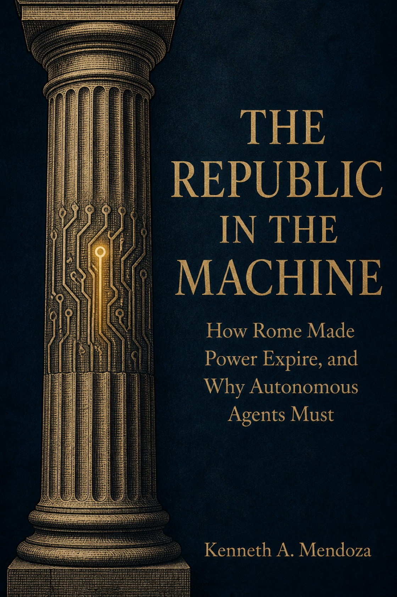

# The Republic in the Machine

## Why AI Agents Need a Last Day in Office

Kenneth A. Mendoza

**Status:** Completed unpublished manuscript; preparing literary-agent submissions.

*Concept cover; artwork retains an earlier subtitle.*

## Overview

When software can act on our behalf, who can stop it, and when does its permission end? In The Republic in the Machine, Kenneth A. Mendoza combines personal experience building and checking software agents with Roman institutional history to examine delegated authority. The book follows work that outlives its permission, reports that outrun their evidence, and reviews that fail to change the next action. It asks readers to identify who authorized a job, what means are permitted, who holds the record, who can intervene, and when authority expires. The historical comparison supplies questions for modern systems, with its limits kept explicit. It offers no claim that analogy proves safety.

## Skills illustrated

- Systems thinking: examine permissions, records, interruption and succession together.
- Evidence-based evaluation: distinguish a successful check from evidence that the original task was solved.
- Technical communication: explain software governance through supported historical comparisons and practical questions.

[Public book page](https://kenmendoza.com/book) · [Portfolio index](../README.md)
